# Маркировка за день

Веб-сервис для небольших швейных и текстильных производств Казахстана: от карточки товара до первой партии этикеток с кодом Data Matrix за один день.

Маркировка товаров лёгкой промышленности становится обязательной поэтапно: 01.12.2026, 01.03.2027, 01.10.2027. Цеху на 2-20 человек нужен не обмен документами, а короткая цепочка:

1. карточка товара с GTIN в НКТ;
2. заказ кодов Data Matrix в ИС МПТ (оператор Tañba, АО «Казахтелеком»);
3. печать этикеток на недорогом принтере;
4. отчёт о нанесении и ввод в оборот;
5. выгрузка кодов и статусов в 1С.

Сервис закрывает именно её и снимает частые боли:

- **Потеря символа GS при печати.** Коды печатаются как GS1 Data Matrix: FNC1 в начале, GS между полями кодируется как FNC1. Это проверено декодированием, идентификатор `]d2`.
- **Аннулирование кодов без отчёта о нанесении.** Сервис следит за сроком и напоминает за 7 дней.
- **Карточки НКТ до 19 полей.** Товары импортируются из Excel или CSV.
- **Двойная работа с 1С.** Коды и статусы забираются обработкой по API.

Модель: подписка 5-10 тыс. ₸ в месяц.

Это рабочий прототип. Вместо настоящей ИС МПТ к нему подключён эмулятор True API, вместо ЭЦП работает эмуляция подписи. Оба режима переключаются в `.env`.

## Кому

- Швейные цеха и ИП, которые шьют футболки, худи, бельё, спецодежду и должны маркировать продукцию.
- Бухгалтеры и операторы, которые ведут учёт в 1С:Бухгалтерии 3.0 КЗ или 1С:УНФ КЗ.
- ЦТО и интеграторы, которые подключают таких клиентов.

## Архитектура

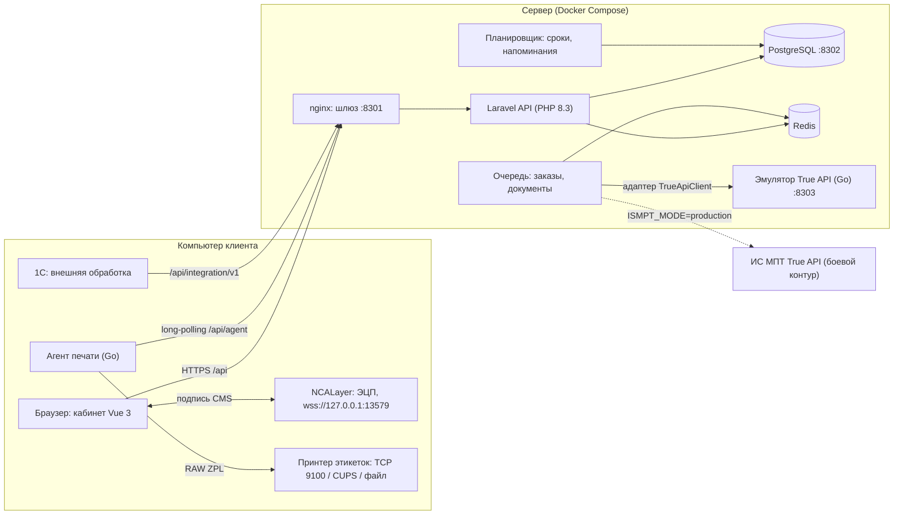

Ключ ЭЦП не покидает компьютер клиента:

1. Сервер берёт у ИС МПТ строку для подписи (`GET /auth/key`).
2. Браузер подписывает её через NCALayer.
3. Сервер обменивает подпись на токен (`POST /auth/simpleSignIn`, токен живёт 10 часов).

Документы (отчёт о нанесении, ввод в оборот) подписываются так же, открепленной подписью.

## Что внутри

| Каталог | Что это |
|---|---|
| `backend/` | Laravel 12: организации, пользователи, товары, заказы кодов, коды и статусы, шаблоны этикеток, печать PDF/ZPL, документы, журнал, напоминания, интеграция 1С, адаптер True API |
| `frontend/` | кабинет на Vue 3 + TypeScript (Vite) |
| `emulator/` | эмулятор ИС МПТ True API на Go (только stdlib), консоль `/emu/` |
| `agent/` | агент печати на Go: берёт задания с сервера и шлёт RAW на принтер |
| `onec/` | исходники внешней обработки 1С (.bsl и описание формы) |
| `docs/openapi.yaml` | описание API, доступно на `/docs/api/` |
| `docs/true-api-notes.md` | выжимка из открытой документации True API 2.18 |
| `seed/seed.json` | начальные данные: фирма и карточки НКТ (общие для бэкенда и эмулятора) |
| `tools/` | проверка Data Matrix (zxing-cpp), сквозной тест, скриншоты |

## Запуск

Нужны только Docker 24+ и make. PHP, Node, Go в систему не ставятся: всё собирается в образах.

```sh
make up        # создаёт .env со случайными паролями, собирает образы и поднимает стек
make test      # тесты PHP (отдельная БД markirovka_test), Go (эмулятор, агент), vue-tsc
make verify    # сквозная проверка по API: заказ, печать, декодирование Data Matrix, ввод в оборот, 1С
make down      # остановить (данные в томах сохраняются)
make reset     # снести тома и поднять заново
```

Адреса (только 127.0.0.1):

| Адрес | Что |
|---|---|
| http://127.0.0.1:8301 | кабинет |
| http://127.0.0.1:8301/docs/api/ | OpenAPI (Swagger UI) |
| http://127.0.0.1:8303/emu/ | консоль эмулятора ИС МПТ (сброс, сдвиг времени) |
| 127.0.0.1:8302 | PostgreSQL |

Первый `make up` идёт несколько минут: composer, npm, сборка Go. Сидер проходит настоящий путь через эмулятор, поэтому история заказов в базе согласована с эмулятором.

## Входы

Пароль у всех: `portal2026`.

| Логин | Роль |
|---|---|
| admin@kendir.test | владелец ТОО «Кендір Тігін» (выдуманная фирма, г. Павлодар, БИН 190440015237) |
| ceh@kendir.test | оператор цеха |

После входа на главной нажмите «Подключить ИС МПТ». В режиме эмуляции подпись ставится без NCALayer.

## Путь «первая партия за день»

1. **Товары.** Добавить вручную или импортировать CSV/XLSX (шаблон на странице). «Проверить в НКТ» ищет карточку. В эмуляторе карточку можно сразу зарегистрировать.
2. **Заказы кодов.** Выбрать товар и количество. Через несколько секунд коды получены, видна дата аннулирования.
3. **Этикетки.** Шаблон 58x40 (одежда) или 43x25 (бельё). Поля: Data Matrix, GTIN, наименование, размер, состав, производитель, серийный номер.
4. **Печать.** PDF для любого принтера или ZPL для Zebra и совместимых. Файл можно скачать или отправить агенту печати.
5. **Ввод в оборот.** Отчёт о нанесении и ввод в оборот, подпись ЭЦП, ошибки ИС МПТ по каждому коду.
6. **1С.** Токен интеграции в настройках, выгрузка CSV/JSON, внешняя обработка (`/downloads/onec-obrabotka.zip`).

Дашборд «Что сделать сегодня» показывает следующий шаг, коды, которые скоро аннулируются, ошибки заказов и документов.

## Переключение на настоящую ИС МПТ

В `.env`:

```
ISMPT_MODE=production
ISMPT_PRODUCTION_URL=https://elk.prod.markirovka.ismet.kz
SIGN_MODE=ncalayer
```

Затем `make restart`.

- Адаптер (`backend/app/Ismpt/TrueApiClient.php`) ходит на `<адрес>/api/v3/true-api/...` с теми же методами: `/auth/key`, `/auth/simpleSignIn`, `/product/gtin`, `/products/info`, `/cises/my`, `/cises/orders/{uuid}/status` и `/result`, `/cises/info`, документы.
- В режиме `ncalayer` кабинет подписывает через NCALayer: модуль `kz.gov.pki.knca.basics`, метод `sign`. Если модуля нет, используется `kz.gov.pki.knca.commonUtils`, метод `createCAdESFromBase64`.
- Браузер должен один раз доверять `https://127.0.0.1:13579`.

Где эмулятор отступает от открытой документации, написано в `emulator/README.md`, раздел «Что предположено». Главное:

- в True API 2.18 нет эмиссии кодов (это API СУЗ);
- нет отчёта о нанесении;
- нет ввода в оборот для производства РК.

Перед боевым подключением эти три метода нужно сверить с актуальной документацией Tañba (True API 2.32, API СУЗ), которой нет в открытом доступе.

## Что нужно от клиента

- ЭЦП НУЦ РК юрлица или ИП (ключ для подписи, RSA или ГОСТ) и установленный NCALayer.
- Регистрация в личном кабинете ИС МПТ (https://elk.prod.markirovka.ismet.kz/) с подключённой товарной группой «Лёгкая промышленность».
- Договор с оператором на получение кодов маркировки (типовые договоры на сайте Tañba).
- Карточки товаров в НКТ (GTIN). Сервис помогает собрать данные, импорт из Excel.
- Принтер этикеток: Zebra или совместимый для ZPL, либо любой для PDF. Для агента нужен компьютер в той же сети, что и принтер.
- Для 1С: 1С:Бухгалтерия 3.0 КЗ или 1С:УНФ КЗ с возможностью подключать внешние обработки.

## Ограничения прототипа

- ИС МПТ эмулируется. Эмиссия кодов, отчёт о нанесении и ввод в оборот сделаны по аналогии (см. «Что предположено» в `emulator/README.md`).
- Подпись в режиме эмуляции ненастоящая. Код для NCALayer рабочий, но с живой ЭЦП не проверялся: ключа нет.
- Агрегация (коробки, паллеты), вывод из оборота в кабинете, акты приёма-передачи (СНТ, Акт ПП) не сделаны.
- Одна организация на пользователя. Ролей две, ограничений по ролям пока нет.
- Агент печати берёт задания через HTTPS long-polling, без WebSocket. TLS для шлюза в прототипе не настроен: нужен обратный прокси с сертификатом.
- ZPL рассчитан на 203 dpi. Кириллица в ZPL требует шрифта с кириллицей в принтере (у Zebra Link-OS есть встроенный).
- Обработка 1С дана исходниками. Имена табличных частей в типовых КЗ-конфигурациях нужно сверить на конкретной базе.

## Скриншоты

| | |
|---|---|
| 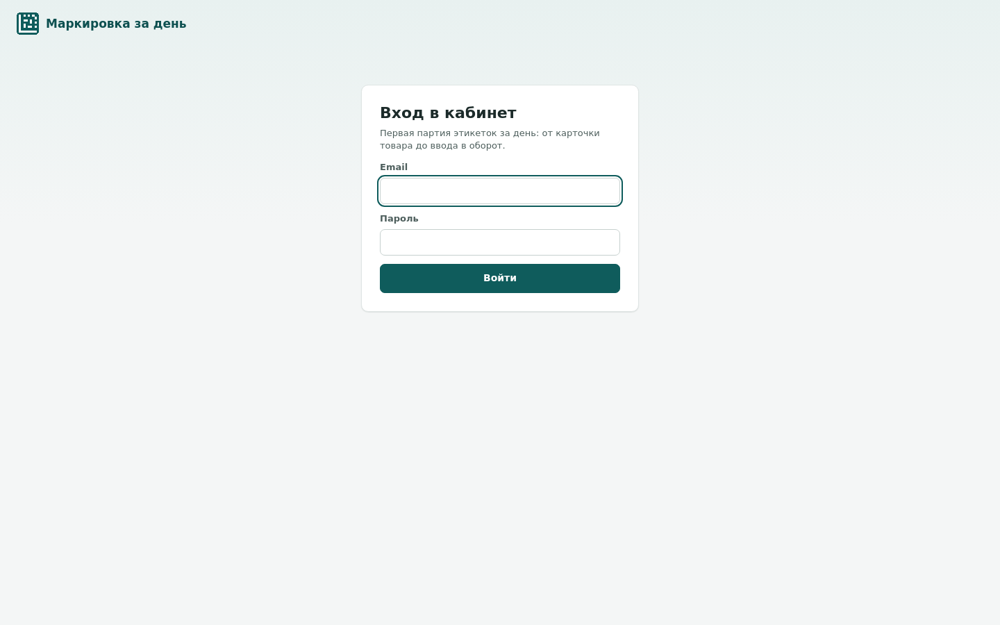 | 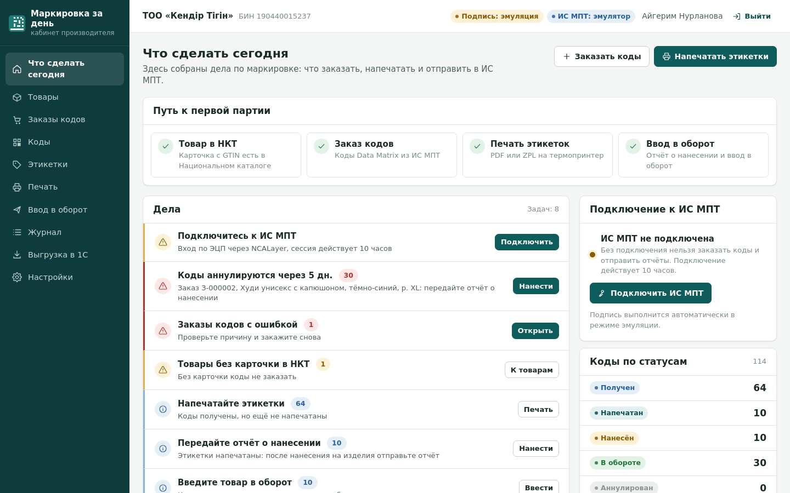 |
| 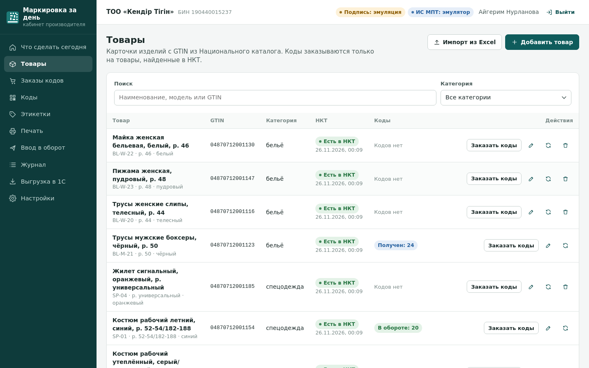 | 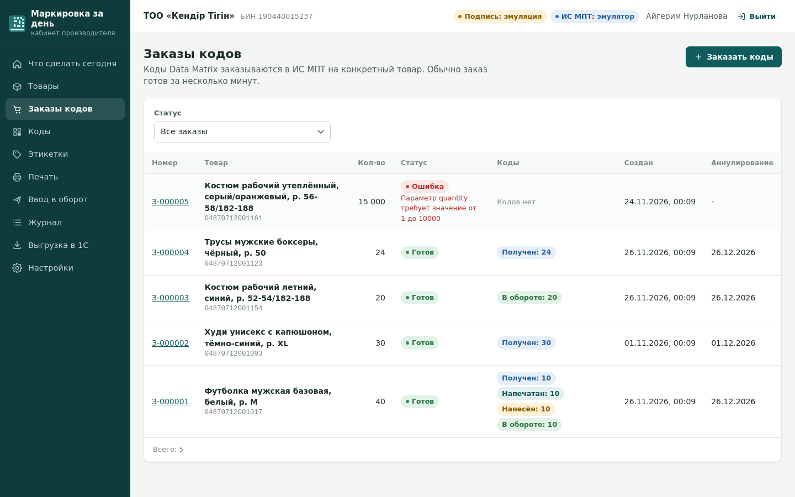 |
| 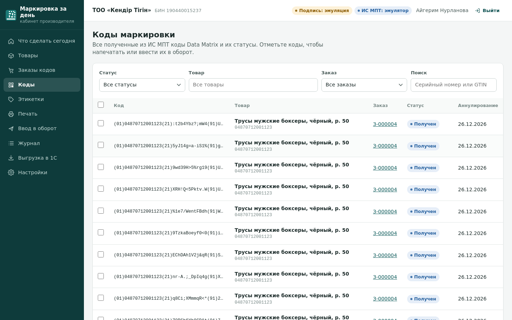 | 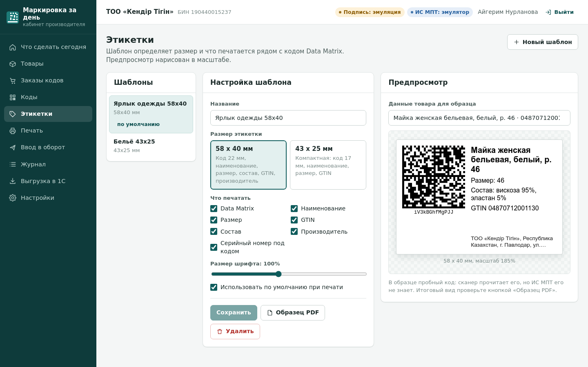 |
| 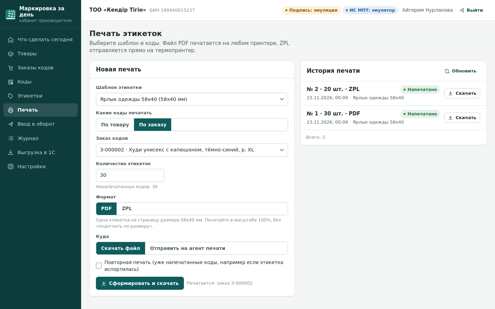 | 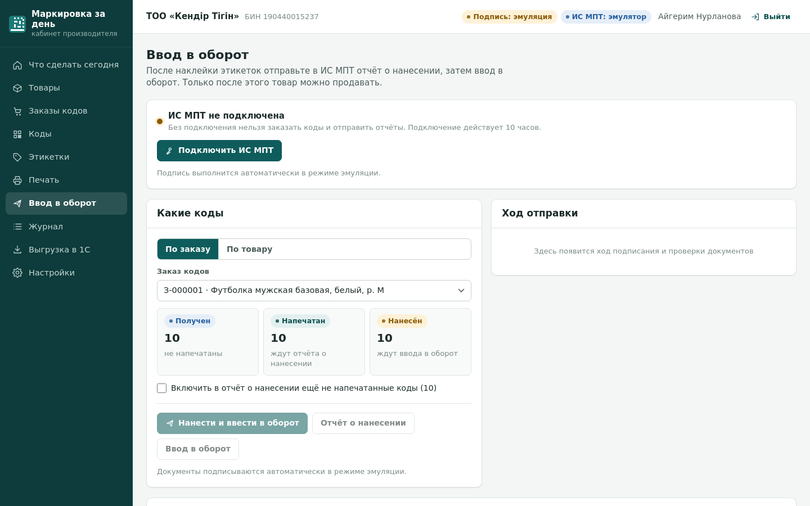 |
| 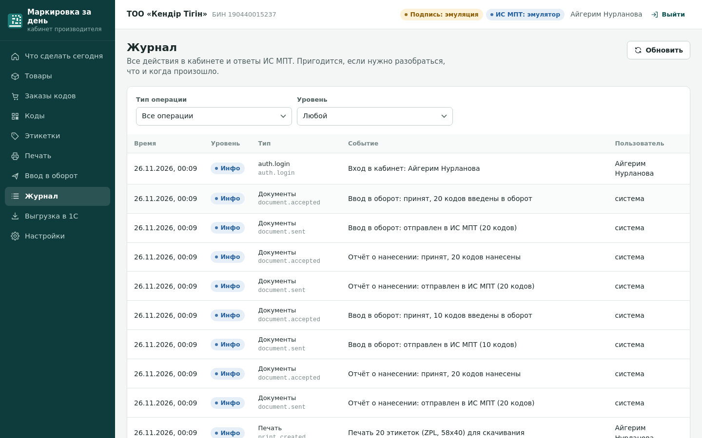 | 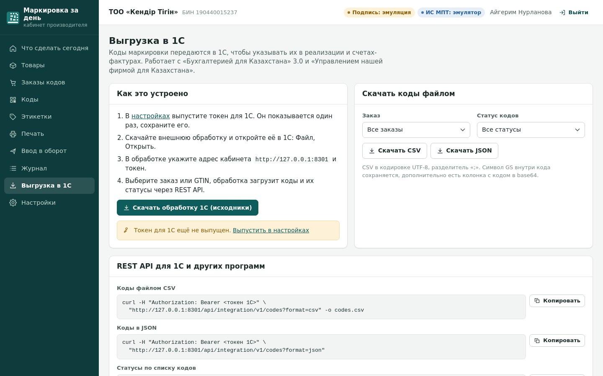 |
| 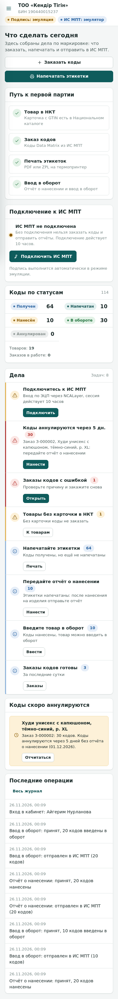 | 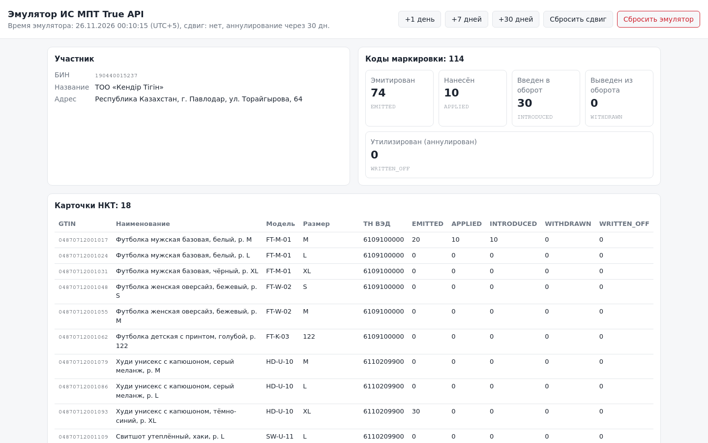 |
